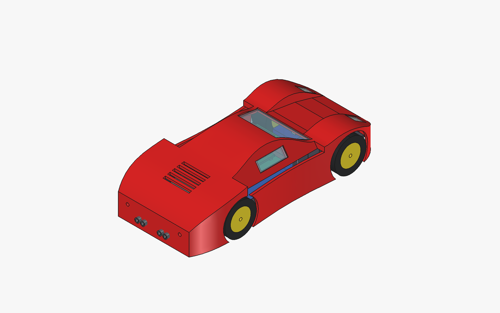
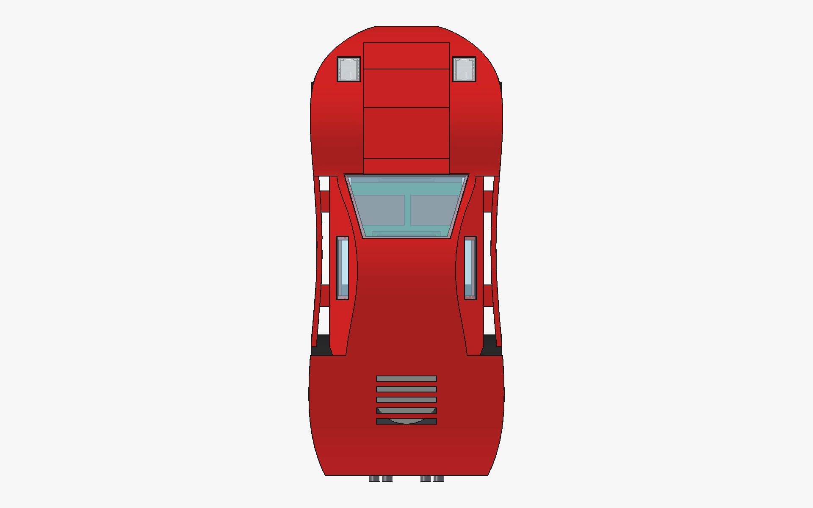
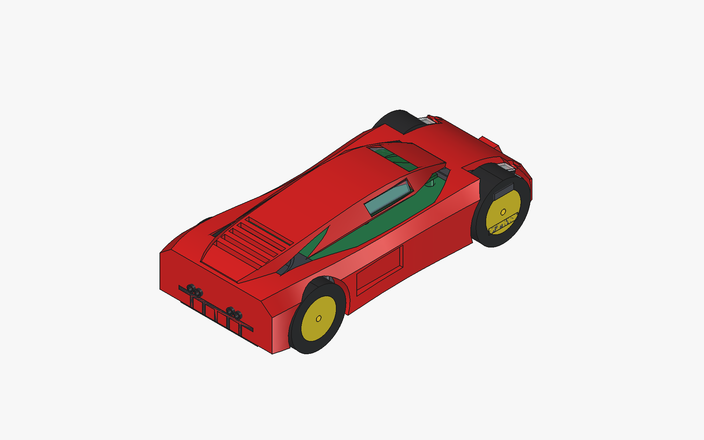
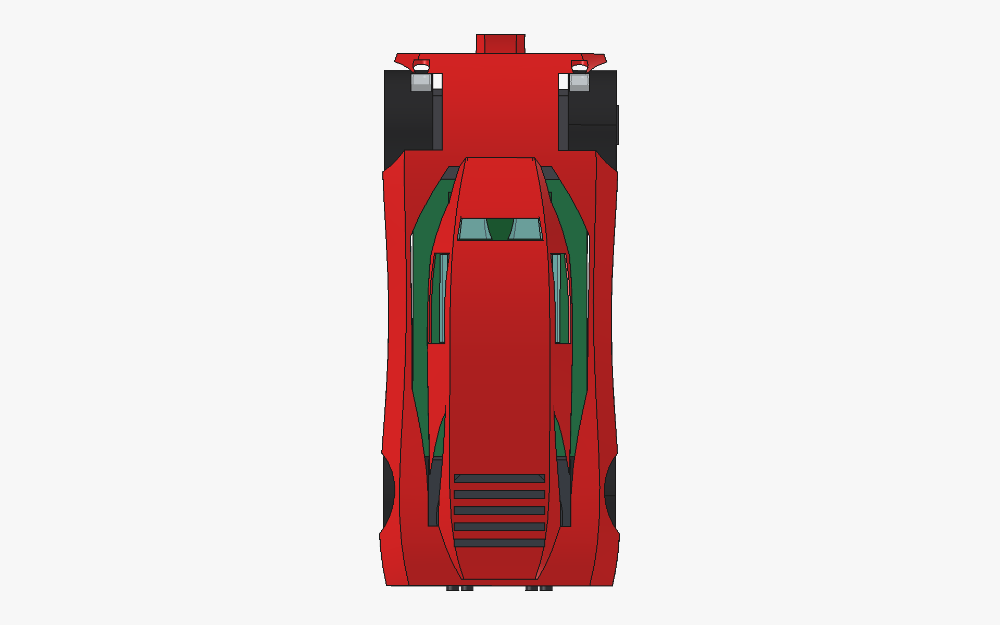
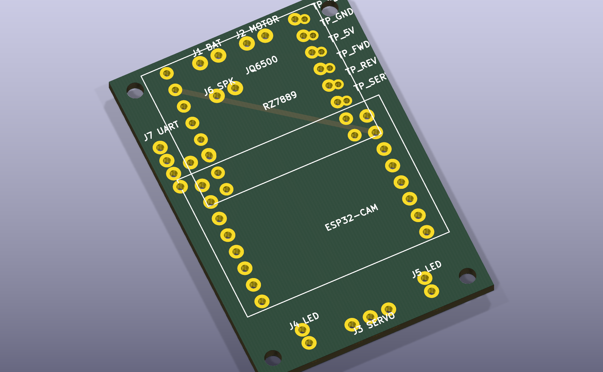
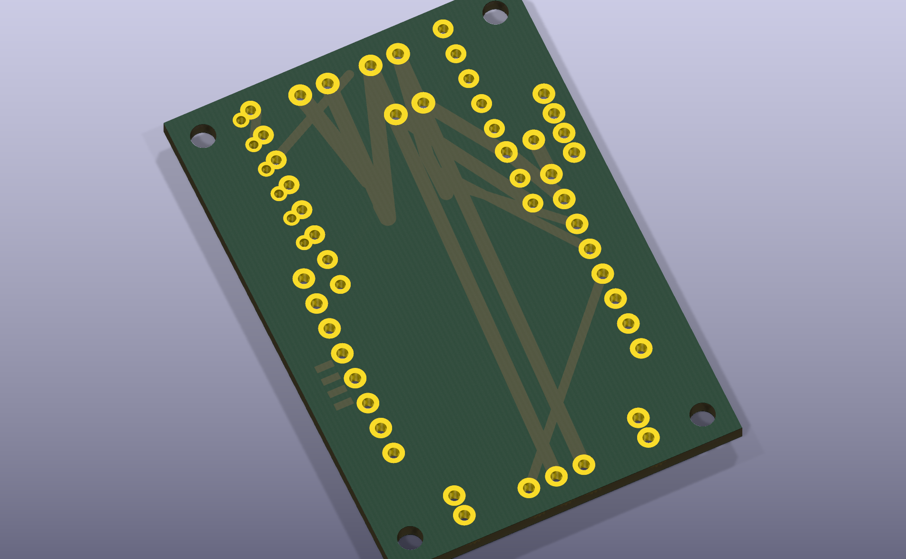
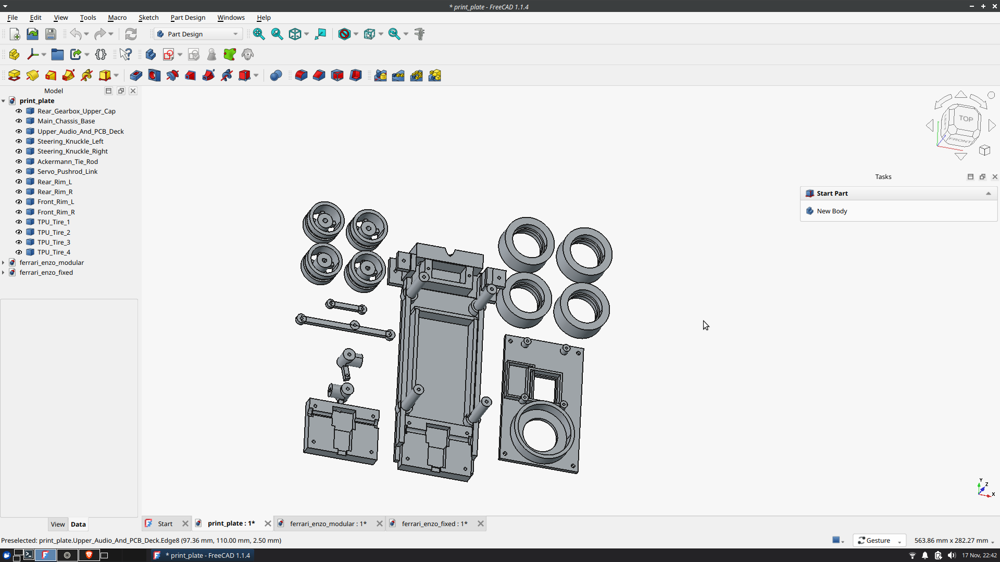
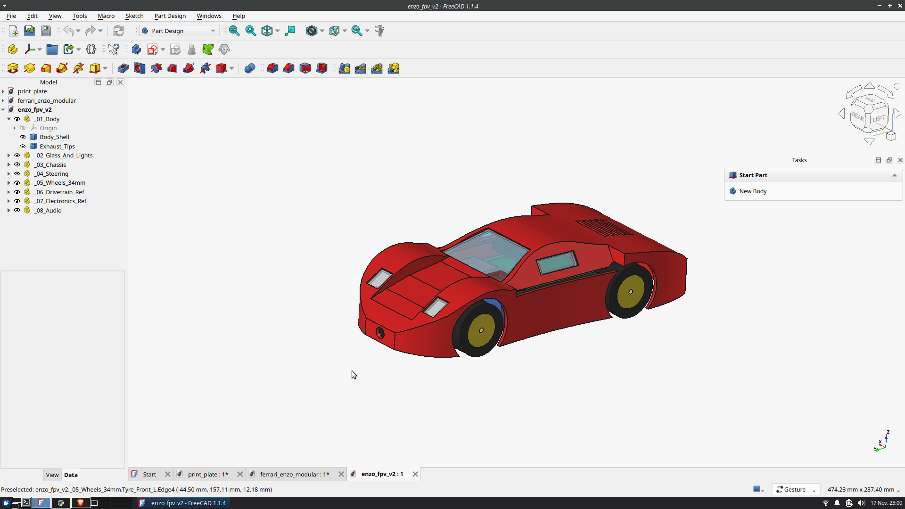
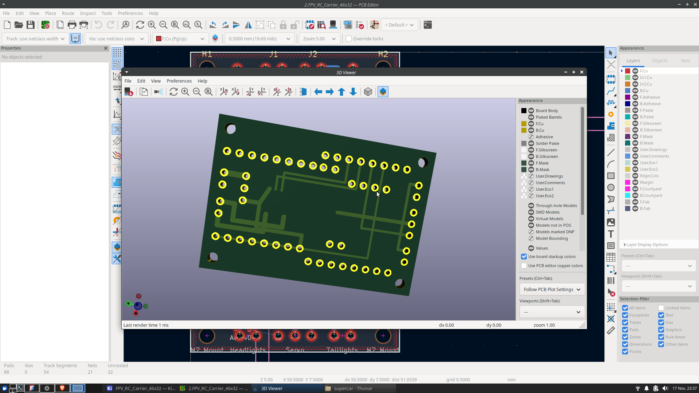
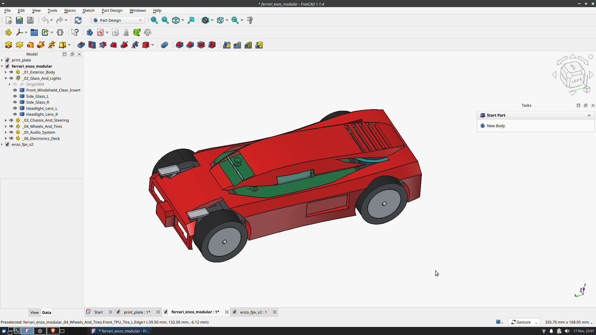

# Supercar — Commercial ESP32-CAM FPV RC Car

> Execution log: project scaffolded from `super car.pdf` (53-page engineering guide).
> All content below is extracted from the PDF and organized as a buildable, version-tracked project.
> No results — only execution artifacts.

## Gallery

### Design renders — Enzo FPV v2 (primary design, FreeCAD)

| Isometric | Top view |
|-----------|----------|
|  |  |

### Design renders — Ferrari Enzo low-profile assembly (alternative design, FreeCAD)

| Isometric | Top view |
|-----------|----------|
|  |  |

### KiCad 46 × 32 mm carrier PCB — 3D render

| Top (component side) | Bottom (copper side) |
|----------------------|----------------------|
|  |  |

### Workspace screenshots (FreeCAD + KiCad GUI)

| Print plate (15 parts flat) | v2 assembly in GUI |
|-----------------------------|--------------------|
|  |  |

| KiCad 3D viewer — component side | KiCad 3D viewer — copper side |
|----------------------------------|-------------------------------|
|  |  |

Shell render of the alternative design:



> All design renders are auto-generated: FreeCAD views via
> `freecad/render_images.py` (GUI `saveImage`), KiCad 3D views via
> `kicad-cli pcb render`.

## What This Is

A complete, production-ready RC car platform built around a single **AI-Thinker ESP32-CAM** module:

| Subsystem | Choice | Why |
|-----------|--------|-----|
| MCU / Camera / Wi-Fi | ESP32-CAM (OV2640) | FPV video + WebSocket control + audio trigger on one chip |
| Rear drive | N20 metal gearmotor (6V–12V, 400–500 RPM) via RZ7889 H-bridge | High speed, isolated axle with MR63ZZ bearings (500 g payload) |
| Front steering | TowerPro SG92R metal-gear servo + Ackermann C-hub knuckles | ±45° steering, no stall burnout |
| Audio | MH-M18 Bluetooth A2DP (phone music) + JQ6500-16P onboard SPI flash (horn/engine) + HXJ8002 3W Class-D mixer amp | Phone streams music; horn cuts over music; zero SD-card corruption |
| Power | 2S 18650 Li-ion + BMS → MP1584EN 5V buck → isolated rails | Anti-brownout for camera Wi-Fi streaming |
| Mechanical | 3D-printed PETG chassis (FreeCAD parametric), snap-on aerodynamic body shell | 500 g payload, printable, commercial kit-friendly |
| Control | ESP32-CAM SoftAP: Port 80 WebSocket (controls) + Port 81 MJPEG (video) | Sub-10 ms latency, non-blocking failsafe |

## Repository Layout

```
supercar/
├── README.md                      # This file
├── docs/
│   ├── BUILD_ROADMAP.md           # Phased execution path (mermaid)
│   ├── HARDWARE_ARCHITECTURE.md   # System topology & pin budget
│   ├── PINOUT.md                  # ESP32-CAM → PCB netlist
│   ├── BOM.md                     # Bill of materials with part numbers
│   ├── PCB_GUIDE.md               # KiCad carrier PCB (46×32 mm) guide
│   ├── FREECAD_GUIDE.md           # Mechanical: gearboxes, chassis, shell, wheels
│   ├── FIRMWARE_GUIDE.md          # Arduino firmware architecture
│   ├── MOBILE_APP.md              # HTML5/JS controller web app
│   └── images/                    # Screenshots: FreeCAD renders + PCB 3D views
├── firmware/
│   └── FPV_Car_DFPlayer_AutoResume.ino
├── freecad/
│   ├── Enzo_FPV_v2.py                    # v2 ground-up rebuild: 1:22.4 scale, dual N20, 8 modules (primary)
│   ├── Ferrari_Enzo_Fixed_Assembly.py    # Alternative: flush glass, sloped headlights, market wheels (6 modules)
│   ├── FPV_RC_Direct_Print_Plate.py      # Master print plate (15 parts flat at Z=0)
│   ├── run_gui.py                        # GUI-mode batch runner → output/*.FCStd + *.stl
│   └── run_headless.py                   # Console-only batch runner
├── kicad/
│   └── generate_rc_pcb.py         # 1:1 printable KiCad PCB generator
├── mobile_app/
│   └── controller.html            # Phone FPV controller (pending)
├── mermaid/
│   └── build_path.mmd             # Build-path diagram source
└── .gitignore
```

## Quick Start (Execution Order)

1. **Read** `docs/BUILD_ROADMAP.md` — the mermaid diagram shows the dependency-ordered build path.
2. **Mechanical** — run the FreeCAD Python macros in `freecad/`, export STL, print in PETG/TPU.
3. **PCB** — run `kicad/generate_rc_pcb.py`, open the `.kicad_pcb` in KiCad, order or etch the 46×32 mm board.
4. **Electronics** — populate per `docs/PCB_GUIDE.md` and `docs/BOM.md`.
5. **Firmware** — flash `firmware/FPV_Car_DFPlayer_AutoResume.ino` to the ESP32-CAM via the 1×4 UART header (GPIO 0 → GND during upload).
6. **Audio** — drag `0001.mp3` (horn), `0002.mp3` (engine), `0003.mp3+` (music) onto the JQ6500-16P USB flash; pair phone to MH-M18 as `RC_CAR_AUDIO`.
7. **Drive** — connect phone to ESP32-CAM SoftAP `RC_FPV_CAR`, open `ws://192.168.4.1/ws` and `http://192.168.4.1:81/stream`.

## Version Tracking

Every change is committed to git. Run:

```bash
git add -A
git commit -m "feat: <description>"
git push
```

See `docs/BUILD_ROADMAP.md` for the mermaid execution path.