# Design Quality Roadmap

> Perspective: Software Engineer + End User who will build, flash, drive, and maintain this RC car.

## Quality Dimensions

| Dimension | Current State | Target State |
|-----------|--------------|--------------|
| **Firmware Robustness** | Basic, fire-and-forget DFPlayer, no watchdog, no OTA, no config persistence | Watchdog, OTA, Preferences config, battery monitoring, DFPlayer ACK checking, reconnection logic |
| **PCB Manufacturability** | Single-layer, no ground plane, no test points, no silkscreen | 2-layer ground pours, test points, silkscreen labels, DRC-clean, decoupling placement |
| **Web App UX** | Basic joystick, no telemetry, no reconnection UI | Reconnection UI, battery/signal telemetry, calibration page, telemetry dashboard |
| **FreeCAD Parametric** | Hard-coded values, no validation, no assembly joints | Parametric constraints, validation, BOM export, assembly workbench |
| **Documentation** | Feature docs only | Troubleshooting, assembly guide, calibration procedure, safety checklist |
| **Project Structure** | Flat, no CI | Build verification, example config, editorconfig, changelog |

## Implementation Order

```mermaid
flowchart LR
    Q1[Q1: Firmware Core<br/>Watchdog + Preferences + OTA] --> Q2
    Q1:::q1
    Q2[Q2: Firmware Safety<br/>Battery monitor + DFPlayer ACK + failsafe] --> Q3
    Q2:::q2
    Q3[Q3: Web App UX<br/>Reconnection + telemetry + calibration] --> Q4
    Q3:::q3
    Q4[Q4: PCB Quality<br/>Ground pours + test points + silkscreen] --> Q5
    Q4:::q4
    Q5[Q5: FreeCAD<br/>Parametric validation + BOM + joints] --> Q6
    Q5:::q5
    Q6[Q6: Docs + Process<br/>Troubleshooting + assembly + safety] --> Q7
    Q6:::q6
    Q7[Q7: Release<br/>Tag v1.0 + changelog + CI]:::q7

    classDef q1 fill:#e1f5e1,stroke:#2e7d32
    classDef q2 fill:#fff3e0,stroke:#ef6c00
    classDef q3 fill:#e3f2fd,stroke:#1565c0
    classDef q4 fill:#f3e5f5,stroke:#7b1fa2
    classDef q5 fill:#e0f7fa,stroke:#00838f
    classDef q6 fill:#fce4ec,stroke:#c2185b
    classDef q7 fill:#eceff1,stroke:#37474f

    linkStyle default stroke-width:2px,fill:none,stroke:#666
```

## Definition of Done per Quarter

- [ ] Code compiles without warnings (Arduino IDE verbose)
- [ ] All safety-critical paths have bounds checking
- [ ] Config persists across reboots via Preferences
- [ ] WebSocket reconnects automatically with backoff
- [ ] PCB passes DRC with 0 errors, 0 unrouted airwires
- [ ] FreeCAD macro passes Check Geometry with 0 invalid shapes
- [ ] Docs include a troubleshooting table with top 10 failure modes

---

**Status**: Q1 in progress — Firmware core quality upgrade